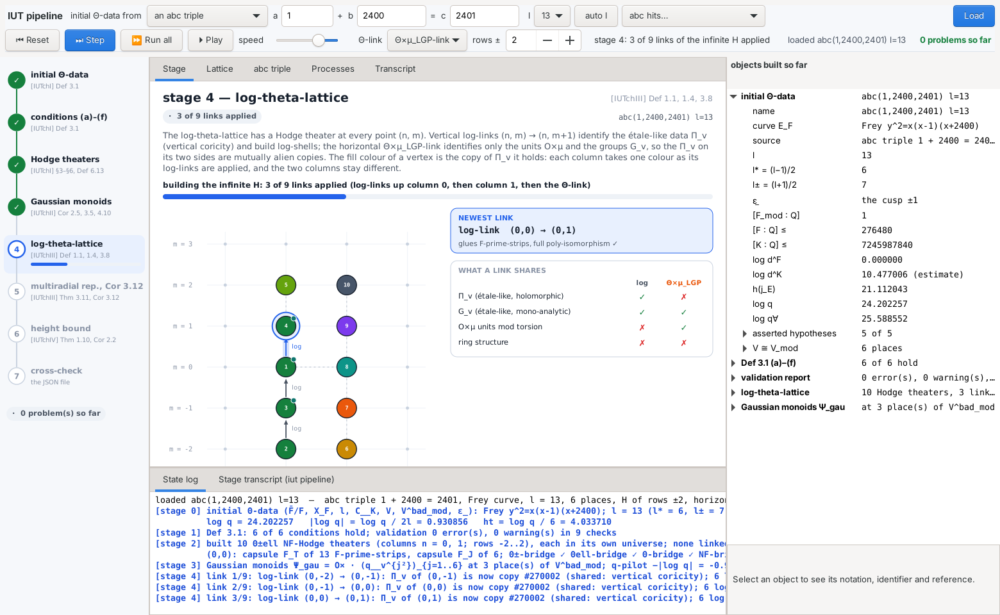
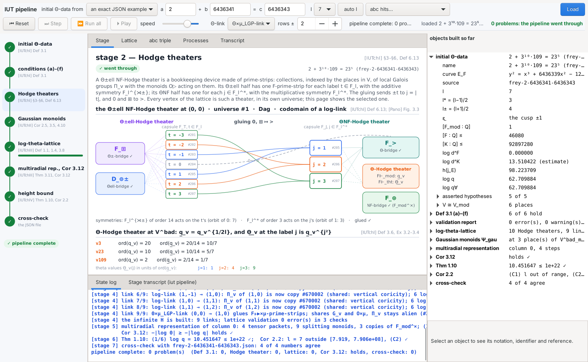
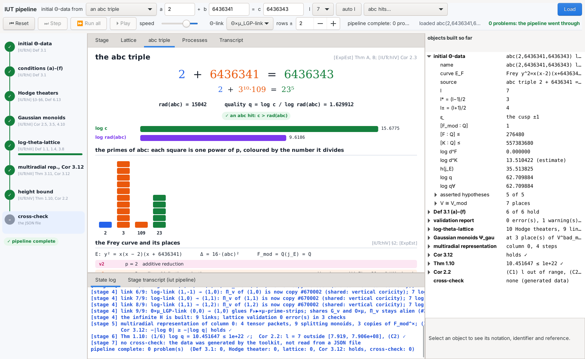
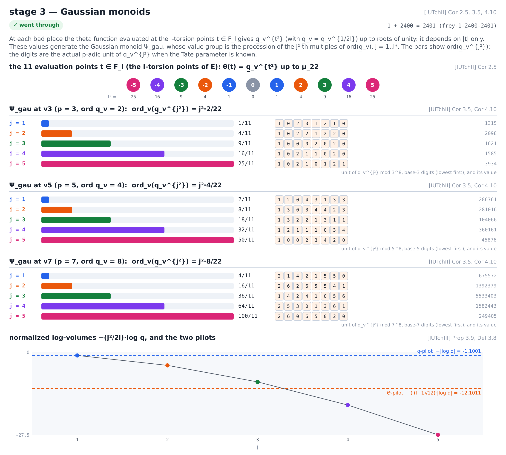
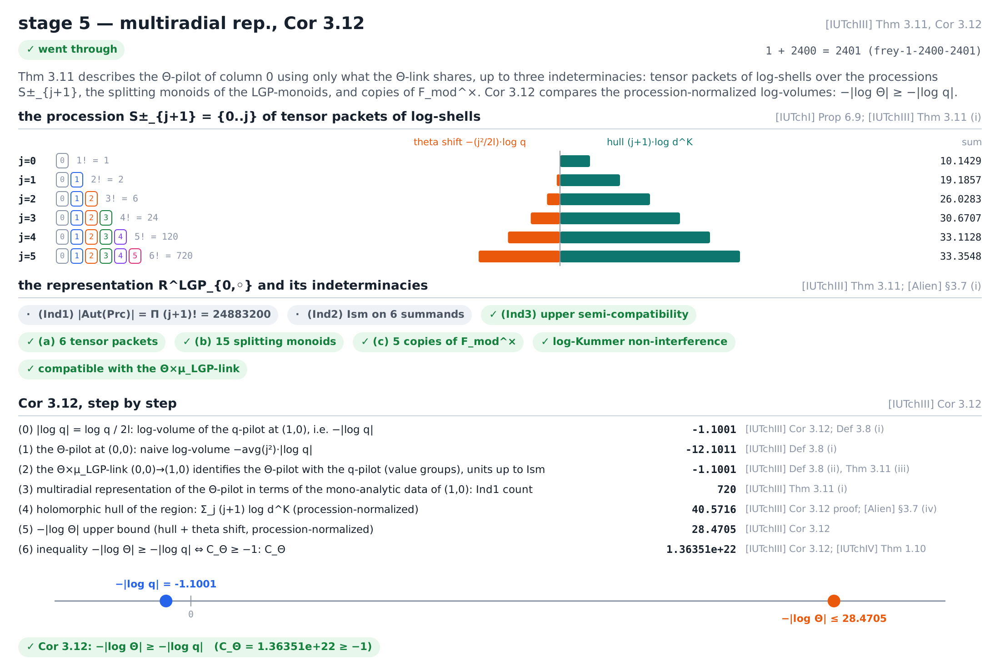

# iut-gui — the IUT pipeline, step by step

`iut-gui` is the graphical counterpart of `iut pipeline` (see [PIPELINE.md](PIPELINE.md)): a native
desktop program, written in C with GTK 3 and Cairo, that links the same library as `iut` and carries one
set of initial Θ-data through the whole theory **one step at a time**, drawing the state after every step.

```sh
cd src
make gui            # Debian/Ubuntu: apt install libgtk-3-dev   macOS: brew install gtk+3   (MSYS2: mingw-w64-x86_64-gtk3)
./iut-gui           # starts on the abc triple 1 + 2400 = 2401 with l = 13
```



## The window

* **The bench** (top row) says where the initial Θ-data comes from:
  * *an abc triple*: type `a` and `b` (c = a + b is filled in), choose the prime `l`, or press **auto l**
    for the smallest prime l ≥ 5 for which the data passes Def 3.1 (l prime to the bad primes and to every
    ord(q_v)). **abc hits…** fills in well-known triples (1 + 8 = 9, …, Reyssat's 2 + 3¹⁰·109 = 23⁵,
    de Weger's 11² + 3²·5⁶·7³ = 2²¹·23). The data is the Frey curve y² = x(x − a)(x + b), as in `iut gen --abc`.
  * *a built-in example* (`iut gen --example K`), *random synthetic data* (`--random SEED`), or
  * *an exact JSON example* from `docs/initial-theta-data/` (Tate parameters to 8 p-adic digits, SL₂ proved).
  
  **Load** builds the data. The second row chooses the flavour of the **Θ-link** (Θ, Θ×μ, Θ×μ_gau,
  Θ×μ_LGP, Θ×μ_lgp) and how many **rows** the infinite H spans, both applied on Load.
* **The controls**: **Step** runs the next stage, and in stage 4 applies the next link of the infinite H;
  **Run all** runs everything left; **Play** steps on a timer (the slider sets the speed); **Reset** goes
  back to stage 0 with the same data. Keys: space or `s` step, `r` run all, `p` play, backspace reset,
  ← → change the stage shown.
* **The stage rail** (left) shows the eight stages, green when a stage went through, red when it failed;
  click one to look at it again.
* **Stage** (centre) draws the stage being looked at:
  0. the initial Θ-data: the tower F_mod ⊆ F ⊆ K ⊆ F̄, the curve and l, every place of V coloured by its
     reduction, the Tate parameters as base-p digits, the asserted hypotheses;
  1. the conditions (a)–(f) of Def 3.1, machine-checked or asserted, and the validation report;
  2. the Θ±ell NF-Hodge theater of the selected vertex: the capsule F_T with its Θ±- and Θell-bridges, the
     capsule F_J with its Θ- and NF-bridges, the gluing ±t ↦ |t| and 0, ⊞ ↦ >, the Θ-Hodge theater at
     V^bad, and all eleven prime-strips, one cell per place, coloured by the copy of Π_v (top half) and of
     the monoid (bottom half) they hold;
  3. the Gaussian monoids: the l evaluation points, ord(q̲_v^{j²}) at each bad place with the p-adic unit
     of q_v^{j²}, and the log-volumes against the q-pilot and the Θ-pilot;
  4. the log-theta-lattice as it is built, link by link (the vertex colour is its copy of Π_v), with the
     newest link, what log-links and the Θ-link share, the Θ-link at V^bad and the log-shells;
  5. the procession of tensor packets, the indeterminacies (Ind1)–(Ind3), Cor 3.12 step by step and the
     inequality −|log Θ| ≥ −|log q| on a number line;
  6. Thm 1.10 and Cor 2.2 on logarithmic scales;
  7. the cross-check against the numbers stored in the JSON file, and the final verdict, next to the
     number of problems `iut pipeline` reports on the same data.
* **Lattice** shows the part of the 9 × 13 lattice that holds Hodge theaters. Click a vertex to select it
  (double-click to see its Hodge theater). Once the pipeline is complete, **↑ apply a log-link** and
  **→ apply the Θ-link** extend the lattice from the selected vertex, as the TUI's `l` and `t` keys do.
* **abc triple** factors a, b and c, computes rad(abc) and the quality log c / log rad(abc), and lists the
  places of the Frey curve.
* **Processes** is the registry of 73 processes (`iut procs`): pick one to run it on the loaded data
  (`iut run <id>`), or run them all.
* **Transcript** is the text of `iut pipeline` for the stages run so far.
* **State log** (bottom) has one line per step, the newest in blue; **Stage transcript** is the
  `iut pipeline` text of the stage being looked at.
* **The inspector** (right) lists every object built so far: the Θ-data and its places, the Def 3.1
  items, every Hodge theater of the lattice (capsules, bridges, prime-strips with their local data at
  every place, pilots, log-shells), every link, the Gaussian monoids, the multiradial representation,
  Thm 1.10 and Cor 2.2. Selecting an object shows the notation, letters-only identifier, kind,
  description and reference from `src/iut_ids.c`; selecting a Hodge theater selects its vertex.

| | |
|---|---|
|  |  |
|  |  |

## It is the same pipeline

`src/gui/gui_model.c` makes the same library calls as `src/iut_pipeline.c`, in the same order. The one
difference is that the infinite H of stage 4 is built with `iut_apply_log_link` / `iut_apply_theta_link`
one link at a time, in the order `iut_lattice_build_H` applies them, after creating the Hodge theaters in
the order it creates them, so universe and copy ids agree too. `make gui-check` (`iut-gui --check`, no
display needed) runs every built-in example, every JSON example and three more triples (one with l = 5,
which Def 3.1 (c) rejects) under three Θ-link flavours, draws every stage, and checks that

* the problem count equals the one `iut pipeline` returns, and
* the lattice built link by link is, as JSON (`iut_json_lattice`), byte for byte the lattice
  `iut_lattice_build_H` builds.

`scripts/test.sh` runs it whenever GTK 3 is installed.

## Pictures without a window

```sh
# one stage as a PNG (2× scale), after running the pipeline (or --steps K):
./iut-gui --theta-json ../docs/initial-theta-data/frey-1-2400-2401.json --render-stage 3 --out stage-3.png --width 1100
#   --render-stage 0..7 = a stage, 8 = the abc page, 9 = the lattice page
# the whole window (needs a display; xvfb-run works):
xvfb-run -a ./iut-gui --abc 1 2400 2401 --l 13 --steps 7 --screenshot window.png --size 1560x960
#   also --tab stage|lattice|abc|processes|transcript, --view N, --run, --select N,M
```

The screenshots in `docs/gui/` were made this way.
