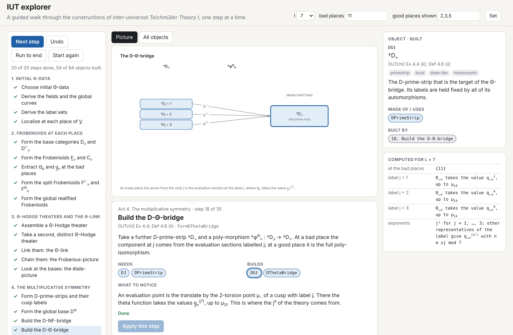
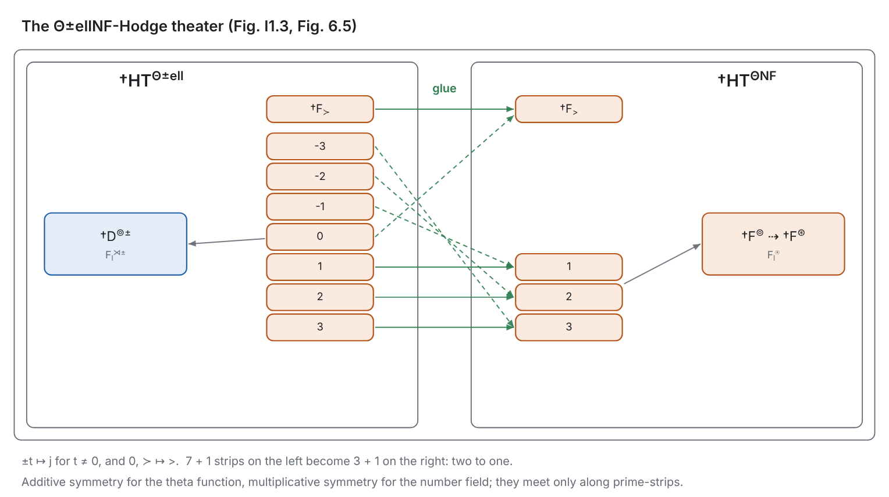

# IUT explorer

A guided walk through the constructions of *Inter-universal Teichmüller Theory I*
(`pdf/Inter-universal Teichmuller Theory I.pdf`), one step at a time, in the terminal
and in the browser.

This is a fresh start. It does not use the process functions, the pipeline, the checks
or the verdicts of `src/`, and it does not treat them as a source of truth. It keeps two
things from the earlier work:

* the table of letters-only identifiers, `src/iut_ids.c`;
* the rule that turns a printed notation into such an identifier (symbol → word,
  `^[A-Za-z]+$`, unique without regard to case).

Everything else here was written from the text of [IUTchI], and every object and every
step cites the definition, example, proposition or corollary it comes from.

## What it is

The paper is treated as a machine with a fixed set of parts and a fixed set of moves.

* **84 objects**, from the initial Θ-data of Def 3.1 to the Θ±ellNF-Hodge theater of
  Def 6.13. Each has an identifier, its printed notation, its place in the paper, a short
  statement of what it is, what it is made of, and whether it is local or global,
  étale-like or Frobenius-like, holomorphic or mono-analytic.
* **35 constructions**, each with the objects it needs and the objects it builds. A step
  can be applied only when everything it needs has been built.
* **6 acts** in the order of the paper: initial Θ-data (Def 3.1), Frobenioids at each
  place (Ex 3.2 to 3.5), Θ-Hodge theaters and the Θ-link (Def 3.6 to Cor 3.9), the
  multiplicative symmetry (§4), ΘNF-Hodge theaters (§5), the additive symmetry and the
  gluing (§6).

You follow the tour with "next", or apply any step that is ready, in any order. The state
is tracked: which objects exist, which step built them, what each step is still waiting
for. Undo takes steps back.

## What is computed and what is described

The explorer holds a prime `l` and a finite window of `V_mod` with each place marked bad,
good or archimedean. From that it computes, exactly, the finite combinatorics of the
labels:

| view | content | source |
|---|---|---|
| `conditions` | the conditions of Def 3.1, each marked checked or assumed | Def 3.1 |
| `labels` | l⍟, l±, F_l, \|F_l\|, F_l^⍟, F_l^⋊± | §I1, §4, Def 6.1 |
| `places` | the model of D_v and F̳_v at each place shown | Ex 3.2 to 3.4 |
| `flstar` | the action of F_l^⍟ on the capsule, and that it is simply transitive | Ex 4.3, Prop 4.9 |
| `evaluation` | the values q̳_v^(j²) of Θ̳_v at the evaluation points | Ex 4.4 (i) |
| `lctransport` | φ^LC_j = j · φ^LC_1 and the class [ε̲] | Ex 4.5, Prop 4.7 |
| `procession` | (l⍟)^(l⍟) labellings reduced to l⍟! | Prop 4.11 |
| `pmaction` | the action of F_l^⋊± on T and the orbits of ±1 | Def 6.1, Ex 6.2, 6.3 |
| `pmprocession` | (l±)^(l±) reduced to l±! | Prop 6.9 |
| `glue` | ±t ↦ j, and 0, ≻ ↦ > | Prop 6.7 |
| `frobenius`, `etale` | the two pictures of a chain of theaters | Cor 3.8, 3.9, 4.12 |

Number fields, elliptic curves, fundamental groups, anabelioids and Frobenioids are
**described, not computed**. The explorer does not construct an elliptic curve and it
does not verify the conditions of Def 3.1 that need one; it lists them as assumed. It
makes no claim about any inequality.

## Run it

Terminal (C11, ncurses if present):

```sh
make -C explorer/c
explorer/c/iutx                       # interactive: n next, Enter apply, u undo, Tab objects, +/− change l
explorer/c/iutx tour --l 11 --bad 3,13 --good 2,5,7     # the whole walk as a transcript
explorer/c/iutx step FormDThetaBridge                   # one step
explorer/c/iutx node DThetaBridge                       # one object, and the steps that build and use it
explorer/c/iutx nodes bridge                            # search the objects
explorer/c/iutx facts lctransport --l 13                # one computed view
explorer/c/iutx check                                   # self-check of the model
explorer/c/iutx ids                                     # identifiers against src/iut_ids.c
```

Browser (plain JavaScript and one canvas, no build step, no server needed):

```sh
open explorer/web/index.html          # or: scripts/serve.sh and visit /explorer/web/
```

Each step has a picture. An object is drawn dashed until it has been built; click it to
read what it is.




## Layout

```
explorer/c/model.c     the objects, the constructions and the tour: the single source
explorer/c/engine.c    configuration, state, facts
explorer/c/main.c      command line and JSON
explorer/c/tui.c       ncurses program
explorer/web/data.js   the model as JSON, generated: make -C explorer/c data
explorer/web/engine.js port of engine.c
explorer/web/fmt.js    plain-text notation to sub- and superscripts
explorer/web/pictures.js, app.js, index.html, style.css
explorer/test.sh       model check, tour, C against JavaScript, state machine
```

`explorer/test.sh` checks that the model is consistent (every identifier is letters only
and unique, every object is built by exactly one step, the tour can be run top to
bottom), that `web/data.js` matches the C model, and that the C engine and its JavaScript
port print the same facts line for line.

## Identifiers

73 of the 84 object identifiers are rows of `src/iut_ids.c`. Eleven are new, formed by
the same rule: `CUnderK`, `XUnderUnderV`, `XArrowV`, `FUnderUnderV`, `ThetaUnderUnderV`,
`QUnderUnderV`, `DCircDotGlobal`, `FCircDotGlobal`, `DJ`, `DT`, `DBoxPlus`. Step
identifiers follow the same rule.

Checking the printed pages of [IUTchI] while writing the model showed three places where
the *notation column* of the table (not the identifiers) differs from the paper:

* `DCircAstGlobal` is given as "D^⊛ = B(C̲_K)^0". The paper writes D^⊚ = B(C̲_K)^0
  (Def 4.1 (v)); D^⊛ is the base that corresponds to C_{F_mod} (Ex 5.1 (i)). The explorer
  uses `DCircDotGlobal` for D^⊚.
* `BoxPlus` and `FBoxPlus` print the target of the Θ±-bridge as ⊞. The paper prints ≻
  (Def 6.4 (i)). The explorer keeps the word `BoxPlus` and prints ≻.
* `FUnderV`, `QUnderV`, `ThetaUnderV` have one underline. The paper prints two: F̳_v, q̳_v,
  Θ̳_v (Def 3.6, Ex 3.2).

The table itself has not been changed.

## What is not here yet

Only [IUTchI]. The Θ-link of this paper is, in its own words, a simplified version; the
Θ×μ_gau-link, the log-link, the log-theta-lattice and the multiradial algorithms are
built in [IUTchII] and [IUTchIII]. They would be further acts of the same model.
